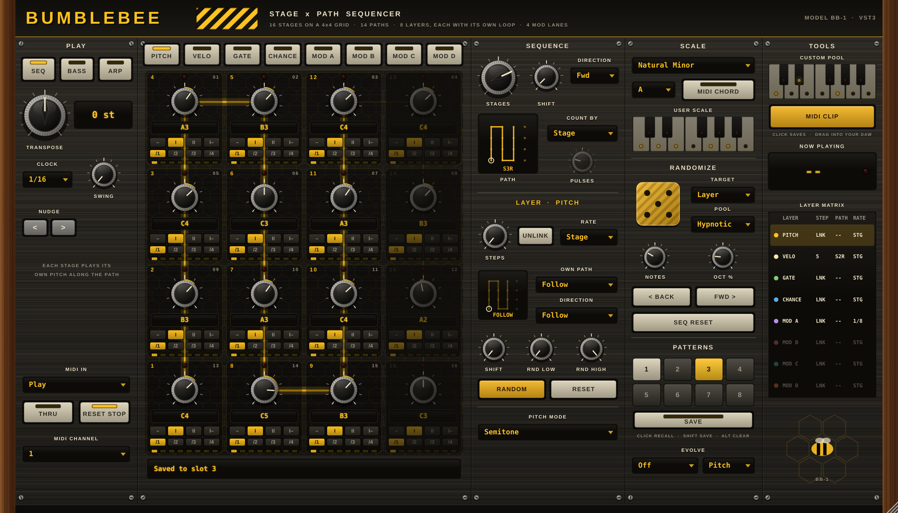

# Bumblebee: Snake + TGB-420 in one sequencer (VST3 / AU)

Bumblebee merges **MDD Snake v3.2.3** and **TGB-420 Sequencer v1.0** into one engine and one panel. The plug-in is built with C++ and JUCE, for Cubase and any VST3 or AU host on Apple Silicon.

- **From TGB-420:** the stage engine. Each stage has 1–8 pulses, a mode (– / I / II with ratchet dividers / I–), Chance, Seq / Bass / Arp, the dice, 8 pattern slots, Evolve, undo, and MIDI Clip.
- **From Snake:** the 4×4 grid with 14 snake paths and a Shift window. Every layer can run polymetrically with its own steps, path, direction, shift and free clock rate. It also brings 36 scales + User scale + MIDI chord, the MIDI remote keys, and CC lanes, now four MOD lanes (A–D).

At default settings Bumblebee plays exactly like TGB-420: on 61 test configurations it produces the same notes as the original `tgb420.js`. `ANALYSIS.md` maps every function of both devices to where it lives in Bumblebee.



## Build on your Mac (M3 Max, Sequoia)
Requirements: Xcode Command Line Tools (`xcode-select --install`) and CMake (`brew install cmake`). The build downloads JUCE 8.0.4 by itself.
```bash
cd Bumblebee
chmod +x build_mac.sh make_installer.sh
./build_mac.sh          # builds, runs the tests, installs VST3 + AU into ~/Library/Audio/Plug-Ins
./make_installer.sh     # optional: dist/Bumblebee-1.0.0.dmg with a .pkg installer (universal)
```
- If you don't have the Mac build tools, push the folder to GitHub and run **Actions → Build macOS installer**.
- Signing works as for the other two ports. The default is an ad-hoc signature. For a notarised DMG, set `DEV_ID_APP`, `DEV_ID_INSTALLER` and `NOTARY_PROFILE`.

## Using it in Cubase
1. Load **Bumblebee** on an **Instrument track**. It makes no audio; it sends MIDI.
2. On your synth's track, set **MIDI input** to **Bumblebee** and turn on **Monitor**. Press Play.
3. Set **MIDI IN** to choose what the keys you play into Bumblebee do:
   - **Play:** keys feed Bass and Arp.
   - **Remote:** Snake's keys. C4–B4 sets the root, C2 rolls everything, D2 rolls the pitches, and C3–B3 sets the User scale when MIDI CHORD is on.
4. **MOD A–D** each send a CC, Pitch Bend or Aftertouch. Use LEARN to pick up a knob on your controller.
5. **MIDI Clip:** click it to save a cycle to `Music/Bumblebee`, or drag it onto a track.

## Quick tour
| Area | What it does |
|---|---|
| Layer tabs | PITCH, VELO, GATE, CHANCE, MOD A–D. The 16 dials show the selected layer. |
| Grid | 16 stages. The amber line is the sequence path. The small number is each stage's place on the path; cells outside the Stages window are dimmed. A dashed line in the layer's colour shows that layer's own path. |
| SEQUENCE | Stages, Shift, Direction, Path (click the picture for the next path, shift-click for the previous), Count by Stage/Pulse |
| LAYER | Steps (0 = linked), Unlink/Relink, Rate (Stage or 1/32–1/2 free-running), Own Path, Direction, Shift, random range low/high, Random / Reset for this layer. The extra controls depend on the layer: Pitch mode (Semitone/Degree), Chance roll, or MOD target / CC / Learn / Step-Glide / Min / Max. |
| SCALE | Off, Snake's 36 scales, Natural Minor, User; Root; the User-scale keyboard; MIDI Chord |
| RANDOMIZE | Dice (Layer / Rhythm / All / Paths), Pool, Notes, Oct %, Back / Fwd, Seq Reset |
| PATTERNS | 8 slots: click to recall (switches at the cycle end), shift-click to save, alt-click to clear, drag to copy. Also Save, and Evolve every N bars. |
| TOOLS | Custom pool, MIDI Clip, Now Playing, Layer Matrix (every layer's steps, path and rate; click a row to edit it) |

## Project layout
```
Source/BeeCore.h            fused engine + editing logic, no framework
Source/BeeParams.h          all parameters (prefix bee_)
Source/PluginProcessor.*    host glue, slots, undo, MIDI in/out/remote, learn, clip export
Source/PluginEditor.*       vintage "honey" panel (1400x800, scales 50-200 %)
tests/bee_test.cpp          unit tests (paths, shift, polymeter, free rate, degree mode, user scale, MOD lanes, slots, editing)
tests/diff_*                differential test vs the original tgb420.js (needs Node; TGB_JS=/path/to/tgb420.js)
tools/snapshot.cpp          UI renders + headless processor test (-DBEE_BUILD_SNAPSHOT=ON)
```

## Status
- **Checked:** the engine tests pass, the differential test gives 61/61 identical, the headless processor test passes, and the UI renders.
- **Not yet checked:** the VST3 compiles on Linux, but the macOS build has not been run, and Bumblebee has not been tried in Cubase or Ableton. Build it on your Mac and check it in Cubase before you rely on it.

The original devices belong to their authors (MDD and The Great Beyond). This is a personal-use rebuild; check their licences before you share it.
