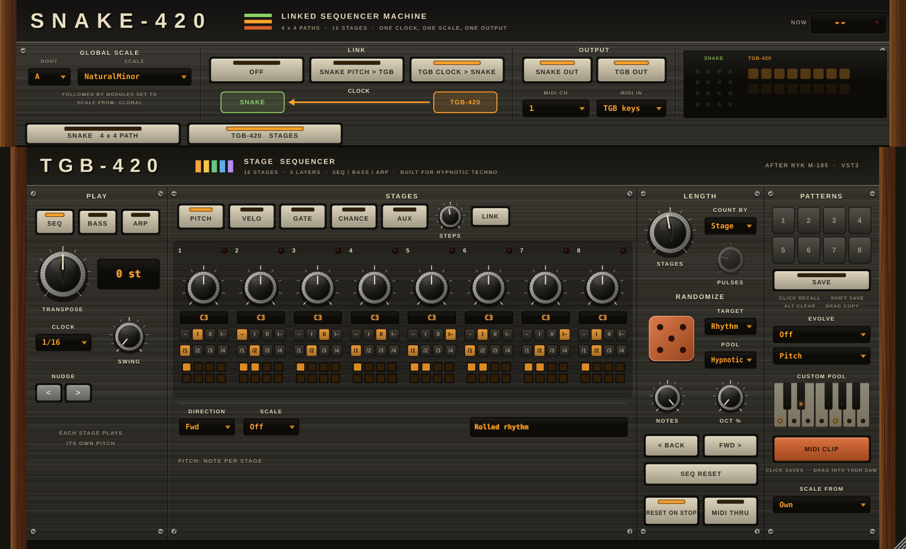

# SNAKE-420: linked sequencer machine

SNAKE-420 combines the Snake and TGB-420 ports in one VST3/AU instrument with MIDI output. Each module runs exactly as its standalone port does, and a **LINK** selector lets one module drive the other. Everything goes out on one MIDI channel.



## The machine
| Section | What it does |
|---|---|
| **Global scale** | Root + 37 scales (Snake's 36 + natural minor). Each module has **Scale from: Global / Own**. Defaults: Snake follows Global, TGB-420 uses its Own (chromatic), so both start as their originals. |
| **LINK: Off** | Both sequencers run on the host clock and merge into one output. |
| **LINK: Snake pitch > TGB** | TGB-420 plays its stage rhythm (pulses, ratchets, chance, swing), but each note takes **Snake's current pitch**. TGB's pitch dials become offsets (±36 st). Snake's own notes can stay on (melody + bass) or go off with SNAKE OUT. |
| **LINK: TGB clock > Snake** | Each TGB-420 note becomes **one step for all Snake lanes**. Snake's 4×4 paths, gates, velocities and CC lanes then play in TGB's rhythm, using each TGB note's time and length. TGB's own notes are used as the clock and are not sent; its Aux still is. Snake's lane speeds and swing are ignored in this mode. |
| **Output** | SNAKE OUT / TGB OUT on/off, MIDI channel |
| **MIDI in** | TGB keys (Bass/Arp/Learn/Thru), Snake remote (root, random, chord → user scale), or both |
| **Monitor** | live 4×4 grid for Snake + 16-stage row for TGB-420; NOW shows the last note sent |
| **Pages** | SNAKE and TGB-420: the full module faceplates, unchanged apart from a "Scale from" selector |

## Build on your Mac
```bash
cd Snake420
chmod +x build_mac.sh make_installer.sh
./build_mac.sh          # builds, runs all tests, installs SNAKE-420.vst3 / .component
./make_installer.sh     # optional: dist/SNAKE-420-1.0.0.dmg (universal, .pkg inside)
```
It needs Xcode Command Line Tools and CMake; JUCE 8.0.4 is downloaded automatically. You can also build the DMG on GitHub: **Actions → Build macOS installer**.

## Cubase
Load **SNAKE-420** on an Instrument track. On your synth's track, set MIDI input to **SNAKE-420** and turn on Monitor. To send keys to TGB-420's Bass/Arp, record-enable or select the SNAKE-420 track and play.

## Code layout
```
Source/Global.h               machine parameters (g_*), global scale list, link modes
Source/PluginProcessor.*      runs both modules each block and routes the link
Source/PluginEditor.*         master strip, link diagram, monitor, module pages
Source/snake/                 Snake engine + module + UI (parameters snake_*)
Source/tgb/                   TGB-420 engine + module + UI (parameters tgb_*)
Source/VintageLookAndFeel.h   shared look
tests/                        snake_test, tgb_test, link_test, diff test vs tgb420.js
tools/snapshot.cpp            UI renders + headless test of every link mode
```
