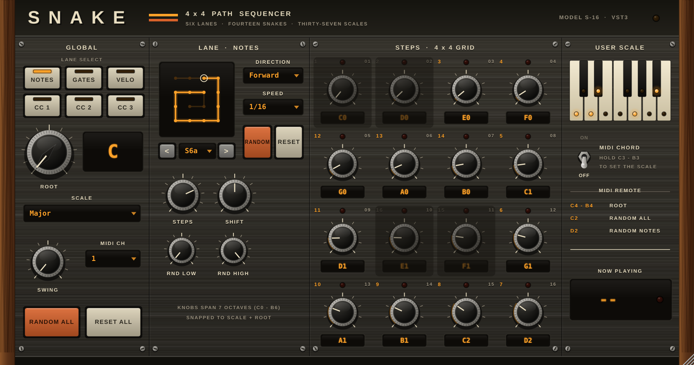

# SnakeSeq: VST3 port of the "Snake" Max for Live sequencer

SnakeSeq is a C++/JUCE rebuild of the MDD Snake v3.2.3 M4L MIDI device. It plays in Cubase (and any VST3/AU host) on Apple Silicon. The sequencing logic follows the original patch exactly; see `ANALYSIS.md` for how the device works and how each part was ported.



## Build on your Mac (M3 Max, macOS Sequoia)

Requirements: Xcode Command Line Tools (`xcode-select --install`) and CMake (`brew install cmake`).
The script downloads JUCE 8.0.4 automatically. If you already have a JUCE checkout, put it in `./JUCE` or pass `-DJUCE_DIR=/path`.

```bash
cd SnakeSeq
chmod +x build_mac.sh
./build_mac.sh
```

The first build takes a few minutes. The script:
- builds a native arm64 **VST3**, **AU** and a **Standalone** app;
- runs the engine unit tests;
- installs the plug-ins to `~/Library/Audio/Plug-Ins/VST3` and `~/Library/Audio/Plug-Ins/Components`.

For a universal (Intel + Apple Silicon) build, run `ARCHS="arm64;x86_64" ./build_mac.sh`.

## Making a DMG installer

```bash
./make_installer.sh
```
This creates `dist/SnakeSeq-1.0.0.dmg`. It is a universal build (Apple Silicon and Intel) and contains a standard **.pkg installer**, which installs the VST3, the AU and the Standalone app system-wide. A drag-and-drop DMG doesn't suit plug-ins, because they have to go into specific Library folders.

- Without an Apple Developer ID, the installer is ad-hoc signed. It installs fine on your own Mac. On other Macs, users need to right-click the .pkg and choose **Open**, or allow it under System Settings > Privacy & Security.
- With a Developer ID ($99/year), set `DEV_ID_APP`, `DEV_ID_INSTALLER` and `NOTARY_PROFILE` (see the top of the script) to get a signed, notarised DMG that opens without warnings.
- **No Mac build tools?** Push this folder to a GitHub repository. Under **Actions**, run **Build macOS installer**, then download the DMG from the run's Artifacts (see `.github/workflows/build-mac.yml`).

## Using it in Cubase

Cubase does not load third-party VST3 *MIDI effects* into MIDI insert slots. For that reason, SnakeSeq is built as an **instrument with a MIDI output**, which Cubase supports.

1. Add an **Instrument track** and load **SnakeSeq**. It produces no audio.
2. Add a **MIDI track** (or an instrument track with your synth).
   Set its **MIDI input** to **SnakeSeq – MIDI Out** and turn on **Monitor**.
3. Press Play. SnakeSeq follows Cubase's transport and tempo, and the synth plays.
4. To record the pattern as MIDI, arm the receiving track and record.

### MIDI remote (play notes *into* the SnakeSeq track)
| Note | Action |
|---|---|
| C4 – B4 (MIDI 72–83) | set the Root |
| C2 (48) | Random All |
| D2 (50) | Random Notes lane |
| C3 – B3 (60–71) | when **MIDI CHORD** is ON: the held chord becomes the User scale |

Note names follow Cubase's default, where middle C (MIDI 60) is C3.

### CC lanes
In the original, the three Custom lanes drove any Live parameter through the Live API. A VST3 plug-in cannot reach into other plug-ins, so here each lane sends a **MIDI CC** instead. The defaults are CC 20, 21 and 22, each with an OUT MIN/MAX range. In the receiving synth, use MIDI Learn, or map the CC with Cubase's Quick Controls.

## Project layout
```
Source/SnakeEngine.h        sequencer core, framework-free (lanes, shapes, scales, swing, timing)
Source/Params.h             all ~190 automatable parameters
Source/PluginProcessor.*    host glue: transport, MIDI in/out, randomise/reset, state
Source/PluginEditor.*       the UI (4 modules: Global, Lane, 4x4 Grid, User Scale)
Source/VintageLookAndFeel.h knobs, toggle switches, keycaps, amber displays, all drawn in code
tests/engine_test.cpp       unit tests for the engine (timing, swing, shapes, block-size independence)
tools/snapshot.cpp          renders the UI to PNG + a headless processor test
```

## UI notes
- The window can be resized from its corner. It scales from 70 % to 200 %.
- Double-click a step knob to reset it to its default value. Hover over any control for a popup value.
- Small numbers in each cell: **amber, top-left** = the step's position on the current snake path; **grey, top-right** = the cell number.
- Cells outside the loop window (set by STEPS and SHIFT) are dimmed. The snake display shows the same window.
