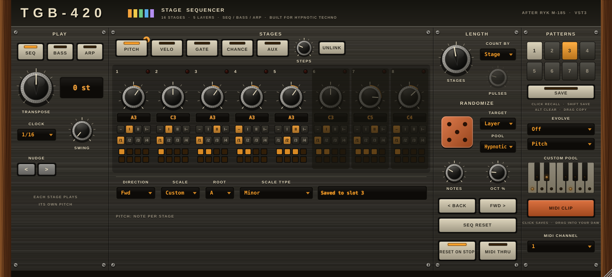

# TGB-420 Sequencer: VST3 / AU port

This is a C++/JUCE rebuild of **TGB-420 Sequencer v1.0** (The Great Beyond), a Max for Live stage sequencer, for Cubase and any VST3/AU host on Apple Silicon. Its timing logic is checked against the original JavaScript engine: on 61 test patterns, the two produce identical notes. `ANALYSIS.md` covers how the device works and what changed in the port.



## Build on your Mac (M3 Max, Sequoia)

Requirements: Xcode Command Line Tools (`xcode-select --install`) and CMake (`brew install cmake`). The build downloads JUCE 8.0.4 automatically.

```bash
cd TGB420
chmod +x build_mac.sh make_installer.sh
./build_mac.sh          # builds, tests and installs VST3 + AU for you
./make_installer.sh     # optional: dist/TGB-420-Sequencer-1.0.0.dmg with a .pkg installer
```
- `build_mac.sh` installs `TGB-420 Sequencer.vst3` and `.component` into `~/Library/Audio/Plug-Ins/`.
- `make_installer.sh` builds a universal (arm64 + x86_64) DMG. Signing works as for SnakeSeq: an ad-hoc signature by default, or set `DEV_ID_APP`, `DEV_ID_INSTALLER` and `NOTARY_PROFILE` for a notarised DMG.
- No Mac build tools? Push the folder to GitHub, then run **Actions → Build macOS installer**.

## Using it in Cubase
1. Load **TGB-420 Sequencer** on an **Instrument track**. It produces no audio.
2. On your synth's track, set **MIDI input** to **TGB-420 Sequencer** and turn on **Monitor**. Press Play.
3. **Bass / Arp modes:** play notes *into* the TGB-420 track (select it, or route a keyboard to it). In Bass mode a key sets the bass note. In Arp mode, hold keys or turn on Latch.
4. **Aux:** sends a CC (default CC 74 Cutoff), Pitch Bend or Aftertouch per stage. In your synth, use MIDI Learn, or LEARN in TGB-420 to pick up a knob from your controller.
5. **MIDI Clip:** click it to save one cycle as `Music/TGB-420/Seq NN.mid`, or **drag the button onto a Cubase track** to drop the clip there.

## Layout
| Section | Controls |
|---|---|
| PLAY | Seq / Bass / Arp, Transpose, Clock, Swing, Nudge; Bass note; Arp style, Oct, Latch, Retrig |
| STAGES | layer tabs (Pitch, Velo, Gate, Chance, Aux), Steps + Link, page 1-8 / 9-16 + Follow; per stage: dial, readout, mode (– I II I–), divider, 8 pulse cells; Direction, Scale; Chance roll; Aux target / CC / Learn / Step-Glide |
| LENGTH / RANDOMIZE | Stages, Count by Stage/Pulse, Pulses; dice, Target, Pool, Notes, Oct %, Back / Fwd (16 undo steps), Seq Reset, Reset on stop, MIDI Thru |
| PATTERNS | 8 slots (click recall at the cycle end, shift-click save, alt-click clear, drag to copy), Save, Evolve + target, Custom pool, MIDI Clip, MIDI channel |

## Project layout
```
Source/TgbCore.h            engine + editing logic (randomize, evolve, nudge), framework-free
Source/TgbParams.h          ~190 parameters, all prefixed tgb_ (ready for a combined plug-in)
Source/PluginProcessor.*    host glue, slots, undo history, MIDI in/out, clip export
Source/PluginEditor.*       vintage UI
Source/VintageLookAndFeel.h shared with SnakeSeq
tests/tgb_test.cpp          unit tests
tests/diff_*.{cpp,js,py}    differential test against the original tgb420.js
tools/snapshot.cpp          UI renders + headless processor test
```
To re-run the differential test, run `python3 tests/diff_run.py`. It needs Node.js and the original `tgb420.js` extracted from the .amxd: put it in `tests/` or set `TGB_JS=/path/to/tgb420.js`.
